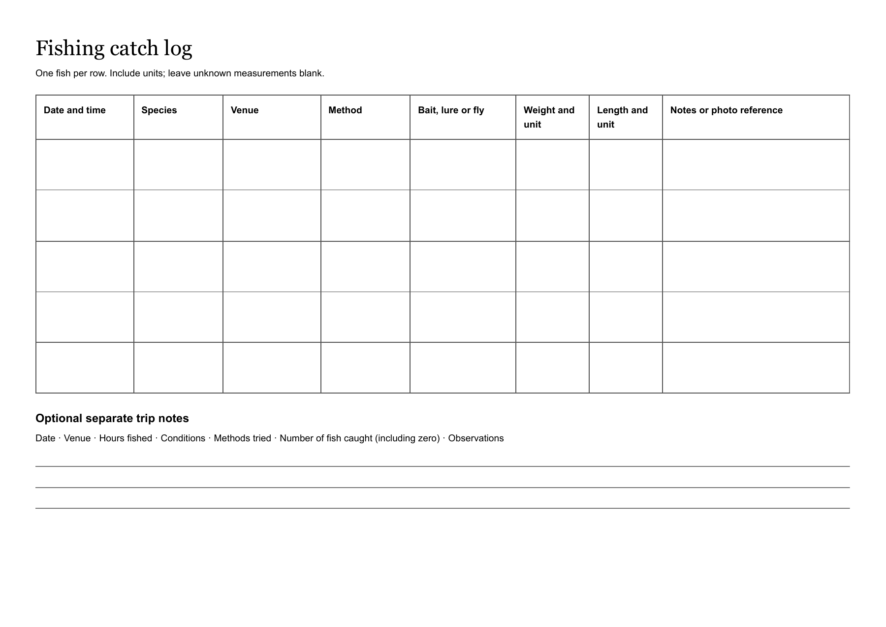

# Fishing journal guide — visual review

**Implementation candidate, not live.** The complete resource is ready to review here without building or deploying it. These are screenshots of the actual locally built Astro pages; the print preview is rendered from the browser's actual PDF output.

## The complete guide

| View | Complete page |
| --- | --- |
| Desktop, 1440 px | [Open the complete desktop screenshot](evidence/guide-1440-complete.png) |
| Mobile, 390 px | [Open the complete mobile screenshot](evidence/guide-390-complete.png) |
| Tablet, 768 px | [Open the complete tablet screenshot](evidence/guide-768-complete.png) |

The complete screenshots use saved rejection of optional analytics so the article is unobscured. The [first-visit 320 px screenshot](evidence/guide-320-first-text1.png) and [enlarged-text first visit](evidence/guide-320-first-text1.6.png) show the shared consent experience.

## Worksheet and actual print output

Mobile shows a clearly labelled first-row preview. The native print action produces all five blank rows and separate manual trip notes. There is no data-entry form, email gate or account requirement.

[Detailed mobile worksheet](evidence/worksheet-390.png) · [Desktop worksheet](evidence/worksheet-1440.png) · [Actual A4 landscape PDF](evidence/catch-log-a4-landscape.pdf)

The PDF is one A4 landscape page with 17 mm blank catch rows, all eight field labels and a separate trip-notes area. The website, navigation, consent controls, app promotion and browser headers/footers are absent. Headers and footers were disabled in the browser print settings, as explained on the page. A physical printer was not used.

## Restrained internal links

| Placement | Before | After |
| --- | --- | --- |
| Journal page, mobile | [Before](evidence/before-journal-link-390.png) | [After](evidence/after-journal-link-390.png) |
| Journal page, desktop | [Before](evidence/before-journal-link-1440.png) | [After](evidence/after-journal-link-1440.png) |
| Journal section in context, mobile | [Before](evidence/before-journal-section-390.png) | [After](evidence/after-journal-section-390.png) |
| Homepage footer, mobile | [Before](evidence/before-home-footer-390.png) | [After](evidence/after-home-footer-390.png) |
| Homepage footer, desktop | [Before](evidence/before-home-footer-1440.png) | [After](evidence/after-home-footer-1440.png) |
| Journal footer, mobile | [Before](evidence/before-journal-footer-390.png) | [After](evidence/after-journal-footer-390.png) |

Before images are from the verified starting main commit `c5a2a9ea6dee8c3b2c0457552ed789605e46f687`. The only existing-page content additions are the guide link beside the journal guidance and one shared footer link. Each existing page still has its two official Play badges.

## Content details

[Illustrative catch record](evidence/example-record-390.png) · [Honest interpretation of records](evidence/read-your-records-390.png) · [Concluding CatchID section](evidence/download-1440.png)

The catch record is labelled illustrative, not a real catch. The product image is the approved historical Personal Records crop already used on the website, not a fabricated interface or a new current-production screenshot. Existing artwork/rights qualifications are retained.

[Technical handover and limitations](HANDOVER.md) · [Exact commit and push receipt](DELIVERY.md)

**Recommended next action: Pete and ChatGPT review this completed resource.** Visual and publication approval remain outstanding.
