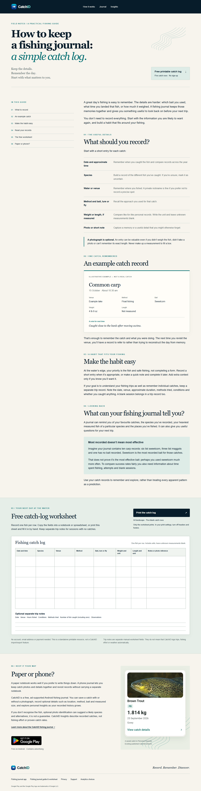
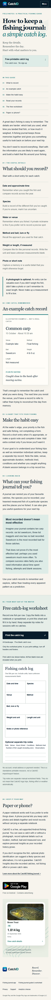
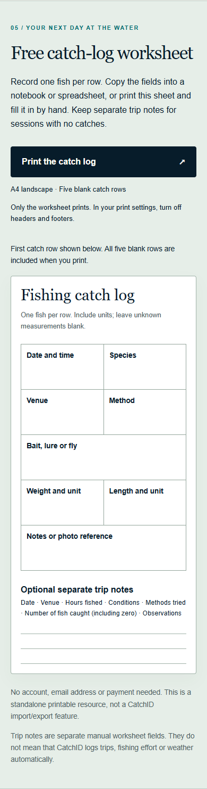
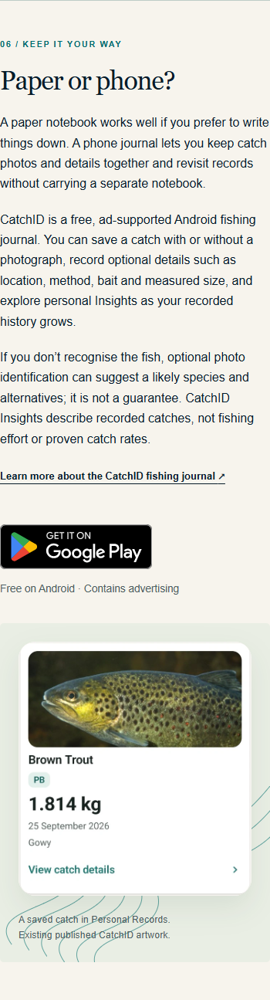
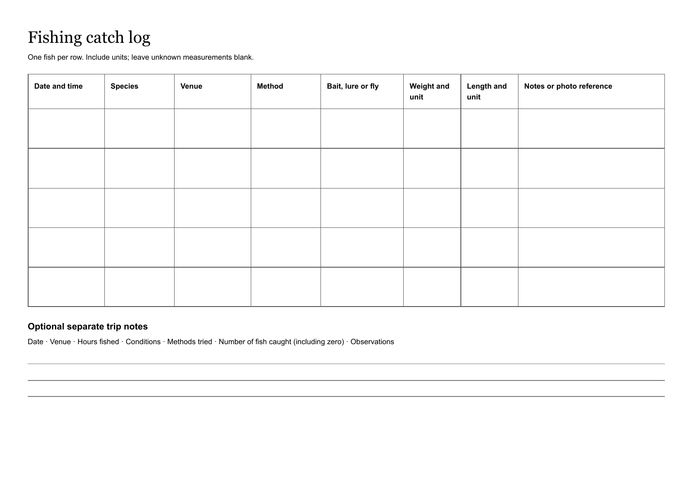

# CID-GROWTH-03 live visual and print review

[Live guide](https://catchid.app/guides/how-to-keep-a-fishing-journal/) · [Live worksheet](https://catchid.app/guides/how-to-keep-a-fishing-journal/#worksheet) · [Publication receipt](RECEIPT.md)

Captured from the actual public deployment of `871ebbeb8e72f0222427002c1ac58f696c328e0d` using controlled Chromium. Analytics was intercepted; no Play navigation occurred. Images explicitly decoded before capture.

## Desktop — 1440 px

## Mobile — 390 px

## Mobile worksheet and concluding badge

## Actual printed worksheet

[Open the actual live A4 landscape PDF](evidence/live-catch-log-a4-landscape.pdf). One page, five blank catch rows, eight fields and separate trip notes. Browser headers/footers disabled.

[First-visit mobile consent capture](evidence/live-guide-390-first.png) · [First-visit desktop consent capture](evidence/live-guide-1440-first.png) · [Live test data](evidence/live-verification.json) · [PDF checks](evidence/print-verification.json)

No physical-printer or real-phone acceptance is implied.
