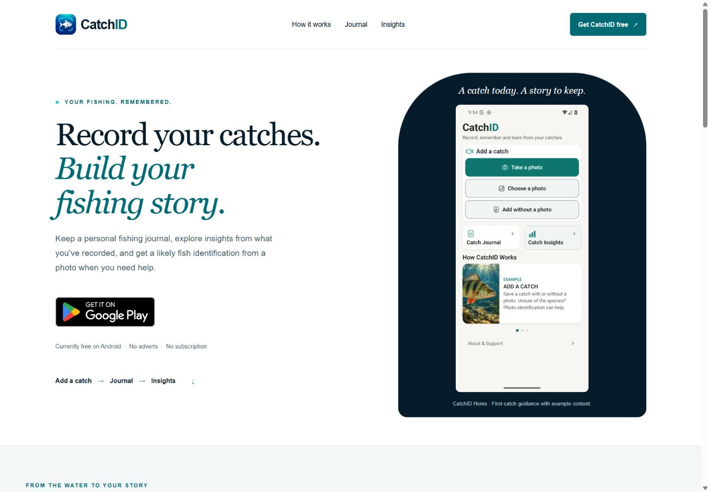
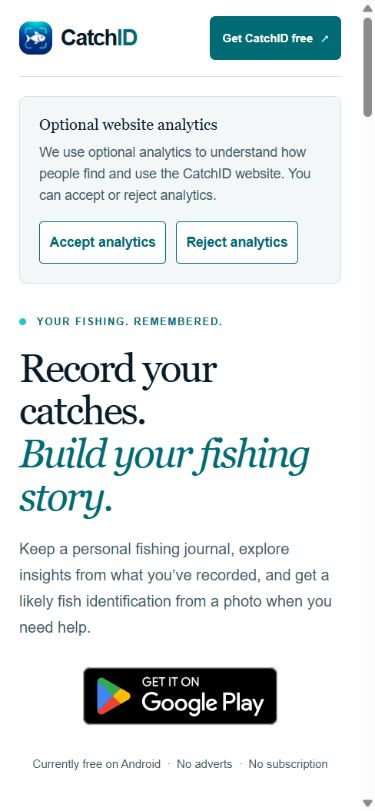
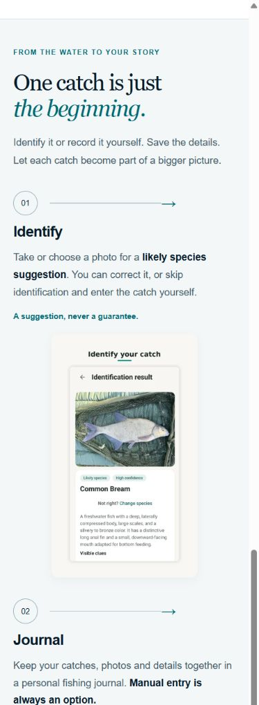
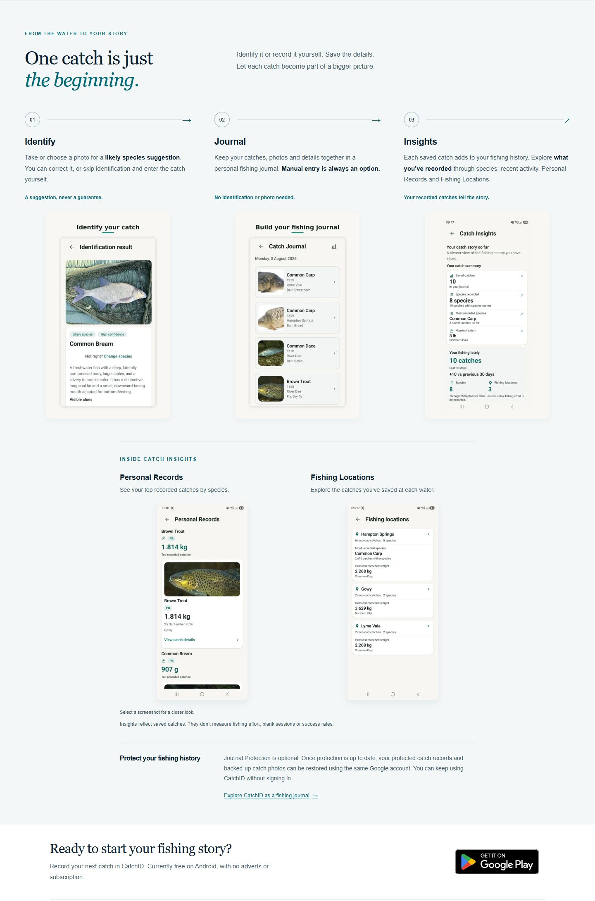
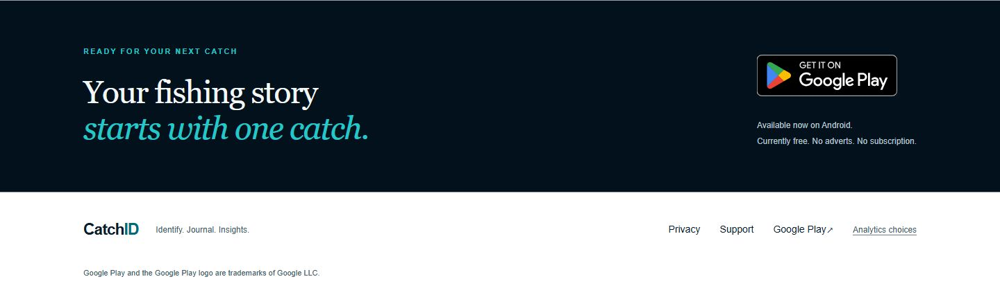

# CID-WEB-CRO-01 — Play Store conversion pass

5 November 2026 implementation · **Approved implementation on `codex/cid-web-cro-01`. Publication authorised 6 November; live outcome must be established by the deployment receipt.**

**6 November 2026 — approval and security-review record:** Pete reviewed the screenshots and approved their appearance (“look ok”), as recorded in his CID-WEB-CRO-01A instruction. The visual gate is closed for unchanged checkpoint `51f44045edea137fa31a69a7df2011e2da83c102`; do not request visual approval again. The [dependency review](DEPENDENCY_REVIEW.md) concludes **NO IDENTIFIED PUBLICATION BLOCKER** for the inspected static candidate, with vulnerable local tooling and dependency-maintenance follow-ups documented. The security review itself was not publication permission; the explicit authorisation below supplies that permission. No Android release is part of this work.

## CID-WEB-CRO-01B — authorised publication

Pete's 6 November instruction explicitly authorises committing the review evidence, fast-forwarding website main from `727b990c974a996f97012d55ac3cb14b83870fe4` to the approved implementation plus documentation, and publishing through the existing main-push GitHub Pages workflow. No duplicate manual dispatch is authorised or needed. The pre-publication SHA above is the rollback baseline.

All non-documentation tracked files must remain identical to `51f44045edea137fa31a69a7df2011e2da83c102`, including source, assets, verification scripts, package/lock files, configuration and workflows. A separate read-only reviewer checked that equality, the report and all six JSON evidence files: no implementation blocker, secret, private catch data or sensitive local path was found; no redaction was required. This separate review applies to B's publication preparation, not a retrospective independent re-run of A's advisory investigation.

The 6 November audit still reports nine affected packages / 32 advisories; it is not clean and no dependency is fixed by publication. Preserve the documented Vite/Sharp and other maintenance follow-ups. Do not expose or use affected dev servers with untrusted browsing/inputs, or add untrusted image processing. This publication task uses no Vite development/preview server.

Pre-publication checks on 6 November passed: `npm ci` (262 locked packages; the existing 9-vulnerability warning remains), `npm run check` (0 errors/warnings/hints), `npm run build` (2 static pages), `npm run verify` (all nine Play links, consent/attribution, HTML/SEO and screenshot-provenance checks), and `git diff --check`. The 1.2.12 Home source hash remains verified. No non-documentation differences from the approved checkpoint were found.

Deployment source SHA and run, served-page/asset identity, analytics-isolated live smoke and final status are recorded in the subsequent Android continuity receipt. A commit or successful build alone does not establish LIVE. No further UI, dependency, workflow, DNS, Android, Play, backend or growth change is included.

## Baseline and boundaries

The existing website checkout started clean on `main` at `bf2022360db94568c7a24d9038aef8c04344fe9d`. After a safe fetch, remote main was `727b990c974a996f97012d55ac3cb14b83870fe4` (local was 0 ahead / 1 behind), matching the task brief. Main was safely fast-forwarded, then this fresh branch was created in an isolated worktree. Existing ignored `.astro/`, `.npm-cache/`, `dist/` and `node_modules/` were preserved. There was no tracked or untracked website work. The enclosing workspace contains other repositories, emulator/release artifacts and evidence; none were cleaned or reset.

`measurement/play-store-attribution` remains untouched at `7db9356`, 6 ahead / 1 behind main. Android main was clean and synchronized at `a7f8b6e7f9a7ab13ba454db1634d9e8b884c93e3`; its latest remote AGENTS and PROJECT_STATUS were read. The status establishes 1.2.12 / code 32 as live from Pete's 2 November Production evidence; this task did not independently access Play Console. Android main also contains the banked, unreleased What's new feature.

## Visible result

- Requested journal-first headline and supporting copy; the existing Currently free / No adverts / No subscription message remains. The hero journey link now starts with Add a catch; the proof journey remains Identify → Journal → Insights.
- Filled teal **Get CatchID free** header CTA, at least 46px tall, with existing keyboard focus treatment. The shared header CTA applies to both pages.
- One official Google Play badge immediately after the complete journey/proof section and before the memory section. The suggested supporting copy uses **Currently free** to avoid a permanent-pricing promise.
- The shared `PlayLink` now accepts `priority`; both above-fold badges use eager/high priority, and later badges stay lazy. Official SVG, dimensions, proportions and 16px clear space are unchanged.
- Genuine current Home evidence replaces the older Journal hero. The taller capture is sized to 270px on desktop to keep the CTA prominent. A caption identifies first-catch example guidance.
- The homepage's five product screenshots are non-navigating at widths up to 600px. Desktop keeps larger-image links. CSS hides the unused presentation from layout, keyboard and accessibility; both reuse the same image assets. No interaction JavaScript or dependency was added. The closer-look note is desktop-only.
- Final CTA/footer content is unchanged. The journal acquisition page keeps its content, metadata and screenshot navigation; only the shared CTA treatment and hero badge priority change there.

## Screenshot provenance

The new Home asset is the unchanged `07-zero-catch.png` from Android HOME-04's versioned emulator evidence: a dedicated API 36 test environment with an empty isolated journal, actual current Home UI and its built-in EXAMPLE guidance. Its SHA-256 matches the original verification manifest. It contains no personal catches, locations or photos, and no device was modified during this task. The Home rendering source matches the 1.2.12 production build-source. This is not a newly captured Play-delivered installation. See [asset provenance](../ASSETS.md#current-home-evidence--cid-web-cro-01).

## Verification

All required commands passed with Node 24.21.0 / npm 11.19.0:

- `npm ci` — 262 locked packages installed; no package/lockfile changes. npm emitted its existing esbuild install-script notice; check and build subsequently succeeded.
- `npm run check` — 0 errors, warnings or hints (12 files).
- `npm run build` — 2 static pages, local optimized images; no client JS artifacts. Home WebP renditions are approximately 24/43/62 KB.
- `npm run verify` — both pages pass generated HTML, canonical/SEO, sitemap, robots, CNAME, internal links, image/asset, truthful-copy and dependency checks.
- `git diff --check` — pass.

Focused checks assert the exact hero message, five homepage / four journal Play links, three / two official badges, exact destinations/default campaigns and non-duplicated install-referrer parameters, eager/high versus lazy loading, the Home asset hash/aspect ratio, one correctly placed mid-page CTA, and the paired mobile/desktop screenshot markup.

The actual generated consent script is executed against every generated Play URL with unset, rejected and granted choices, all supported UTM keys, gclid/gbraid, duplicate incoming keys, unknown parameters, incomplete attribution, repeated activation and withdrawal. It preserves the minimal `play_store_click` event and exactly one referrer without nesting or duplicated parameters. Existing tests also cover storage failures, delayed/failed library load, cookies, cross-tab consent and back navigation. Consent source, GA ID, configuration, Play package, privacy/support URLs and deployment workflow are byte-for-byte unchanged in Git.

The first verification attempt exposed a pre-existing Windows CRLF versus generated LF comparison; the test now normalizes line endings only. The new visible-copy assertion also required decoding `&nbsp;`. Neither correction changes production behavior or weakens consent assertions.

## Browser and visual review

Chromium in-app browser, widths **360, 390, 430, 768, 1024, 1440**: no horizontal overflow on either page at normal size or 1.6× text. Text scaling was tested with a local-only QA response that multiplies each computed text size by 1.6; it is absent from production output. The saved JSON records give measured geometry. A 360px first visit with both large text and the consent prompt also remains usable; the header CTA wraps to its own row.

At 390 × 844 with the original consent prompt open, the hero badge link spans y≈679–771. At 360px it ends at y≈837 (about 37px of scrolling on a 360 × 800 viewport). With a saved choice it is higher. At 1.6× the page naturally requires more vertical scrolling and retains the early header install action.

Manual checks: visible keyboard focus on the header CTA, accessible badge names, mobile screenshot tap stays on the page, desktop enlargement and back navigation work, consent reopen/accept/withdraw/rejected reload work. After acceptance the exact approved Google loader appears; after rejected reload no external script appears. Local-only CSP blocked analytics collection during this browser check. The click-event and referrer behavior is verified by the deterministic generated-script tests, not by a production GA dashboard or a Play install.

Delayed-image browser tests at 390px and 1440px measured the badge and Home before/after real image load: no recorded layout shifts, badge dimensions unchanged; Home rendition rounding was below 0.1px. Static dimensions reserve the image space. No new font/network dependency was introduced.

Self-review found and fixed a large-text caption clipped by the curved hero frame, then rechecked that view and rebuilt/reverified. It also reduced the taller Home capture's desktop size and retained real first-use guidance instead of a personalised fixture containing geometric photos. This was **self-review**, not an independent reviewer. No outstanding implementation defect was found. Conversion lift and physical-device/browser coverage beyond Chromium remain unverified. Pete's visual approval was subsequently received on 6 November, as recorded above.

## Visual review pack

Screenshots are actual browser captures of this build; browser system scrollbar widths can reduce content width inside the stated viewport. Journey images are full-page captures clipped to include the complete section and new CTA at the required width. First-visit and saved-choice states are explicitly distinguished. All lazy product images were loaded before final journey captures. An initial viewport-only export was too short; the final evidence replaces it with the complete journey, without changing the tested website.

### 1440px desktop hero — saved consent choice

### 390px mobile first viewport — consent choices visible

[Mobile with a saved consent choice](evidence/02-mobile-390-saved-choice.jpg)

### 390px mobile journey and new conversion point

[Closer view of the mobile conversion block](evidence/03b-mobile-proof-cta.jpg)

### 1440px desktop journey and new conversion point

### Final CTA and footer — retained

[Mobile footer](evidence/05b-mobile-final-footer.jpg) · [1.6× text caption check](evidence/text-scale-768.jpg)

**Authorised next action (CID-WEB-CRO-01B):** complete pre-publication checks, fast-forward/push main through the existing workflow, then verify the hosted pages before recording LIVE in Android continuity. Appearance and publication are already approved. Keep dependency maintenance separate. This pre-publication handover does not pre-empt the final deployment outcome.
