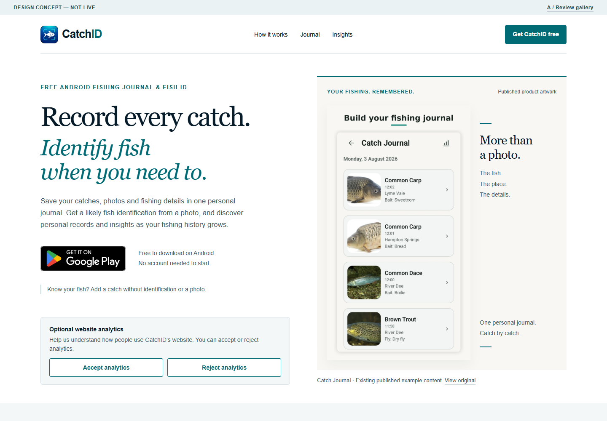
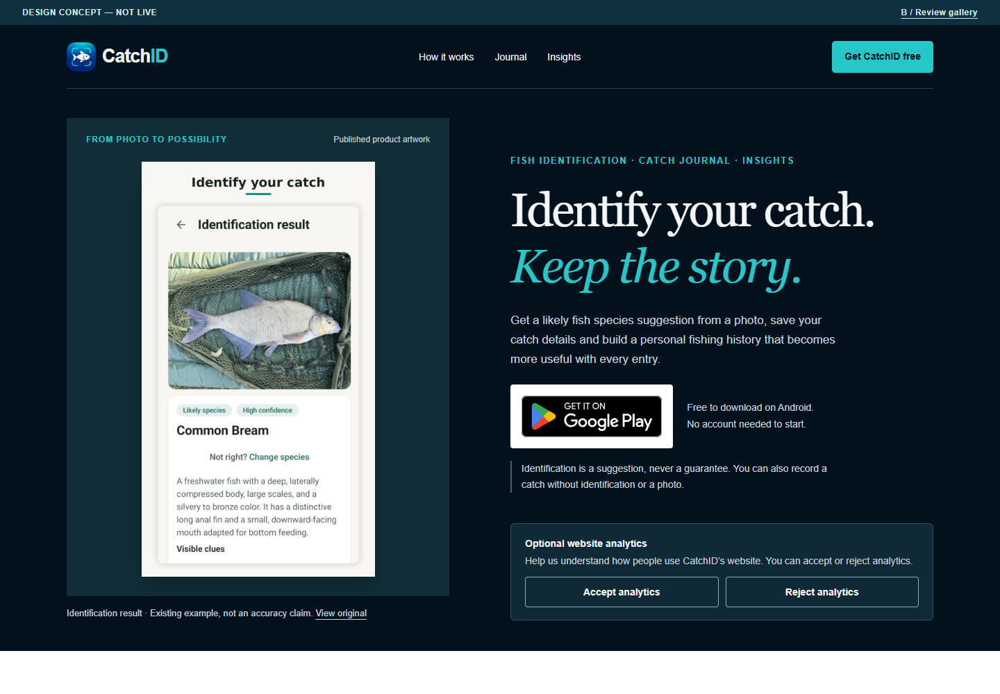
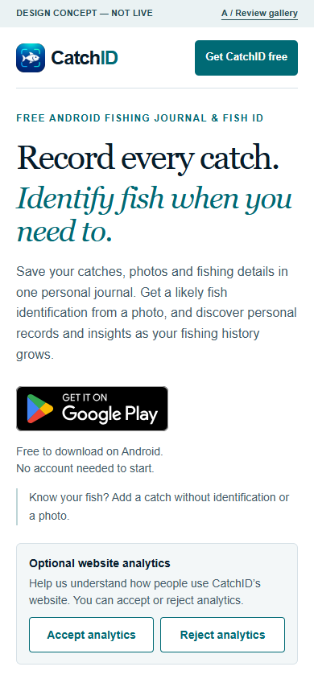
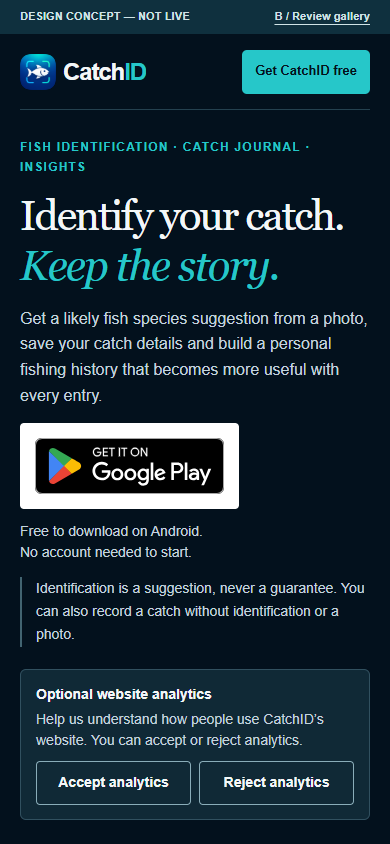
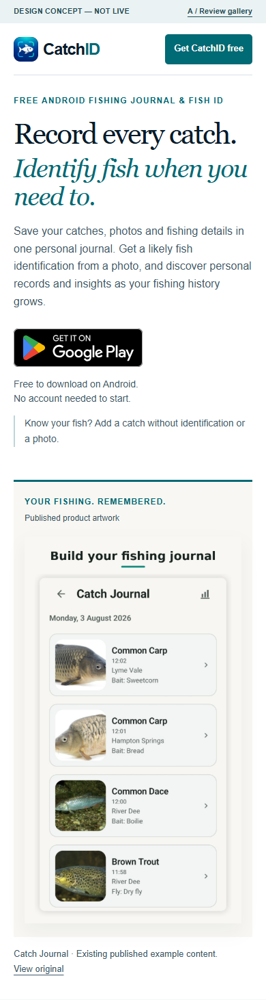
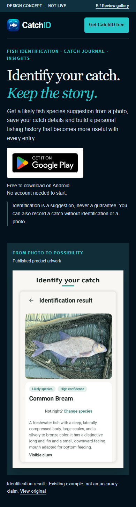
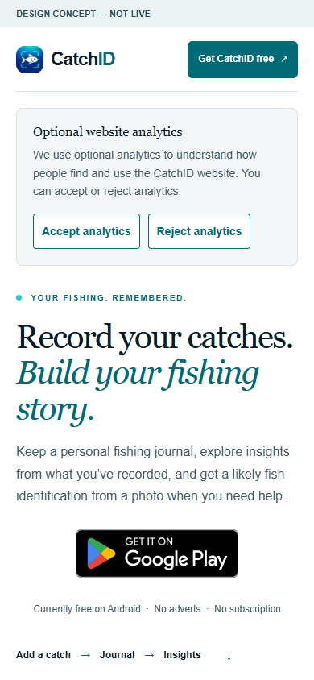

# DESIGN CONCEPT — NOT LIVE

**CID-WEB-CRO-02 · 18 November 2026 · Pete’s approval pending**

[Open the visual comparison gallery](index.html) · [All responsive captures](CAPTURE_INDEX.md) · [Technical handover](HANDOVER.md)

For an offline review, open `index.html` directly in a browser with this folder intact. No installation, development server or runtime dependency is required. GitHub displays the images below directly; it displays HTML as source rather than publishing a preview.

## Two different directions

| Concept A — The journal-first story | Concept B — The action-and-utility experience |
| --- | --- |
|  |  |
| Light editorial typography; a populated Catch Journal is the central proof. Identification is visibly optional. Warm paper around the existing artwork, restrained teal and the established Georgia/Arial pairing. | A navy composition led by the existing identification photograph/result on the left. The headline and download sit on the right; correction, uncertainty and manual recording remain explicit. |
| [First visit](concept-a.html?consent=first) · [Saved choice](concept-a.html?consent=saved) | [First visit](concept-b.html?consent=first) · [Saved choice](concept-b.html?consent=saved) |

The desktop screenshots are 1440 × 1000. Both show equal consent choices beneath the download area. The supporting sections demonstrate the remaining Identify → Journal → Insights journey with separate existing examples, followed by another official badge. Header, hero and lower download principles are retained.

## Mobile

The first row shows the **actual 390 × 844 first viewport with consent visible**. The second row shows the **complete hero extent with a saved choice**, taller than one viewport.

| Concept A | Concept B |
| --- | --- |
|  |  |
|  |  |

At 390px, the primary badge link ends at **551px in A** and **509px in B** regardless of consent state. Both are well within 844px. Normal mobile body text is 16px; header and consent targets are at least 44px high. There are no miniature overlapping screens.

**Trade-off:** full product evidence needs a short scroll, especially with first-visit choices visible. We prioritise the value proposition, official download badge and reassurance. At 1.6× text, the header download remains early while the main badge and consent flow further down; content is not compressed to force everything above the fold. At 320 × 720, consent itself can require scrolling. This is a deliberate reflow, not a hidden choice or overlay.

## Compared with the production hero

| Existing hero, first visit | Proposed A, first visit | Proposed B, first visit |
| --- | --- | --- |
|  |  |  |

The baseline is a browser render of the **unchanged production source at `42c997c`**, built locally. Only the local QA response adds the review label; analytics requests are blocked. These are not freshly captured public-site pixels. The live site was separately read on 18 November and its content matches the inspected source direction.

The baseline download link ends around **733px** with consent visible and **517px** with a saved denial at 390 × 844. A’s saved-state badge is slightly lower than that baseline; B’s is slightly higher. The meaningful first-visit layout change is moving the compact consent presentation below the download, with equal choices, rather than ahead of the proposition. This is a proposal only; the real consent implementation is unchanged.

The proposals replace the current empty-journal Home proof with populated, existing published artwork. They also omit the production site’s outdated advertising-free message. That message remains in the baseline evidence and has **not** been edited on the public site.

## Accessibility and authenticity

- [A at 1.6× text](evidence/a-360x800-first-text160-hero.png) · [B at 1.6× text](evidence/b-360x800-first-text160-hero.png): full hero extents including expanded consent controls.
- [A keyboard focus](evidence/a-360-keyboard-focus.png) · [B keyboard focus](evidence/b-360-keyboard-focus.png): actual Tab navigation to the header download, with 3px focus outlines.
- [A hero badge focus](evidence/a-360-primary-focus.png) · [B hero badge focus](evidence/b-360-primary-focus.png): the focus outline sits inside the badge’s clear-space container so it remains fully visible at the narrow page edge.
- Six requested widths (360, 390, 430, 768, 1024, 1440) plus 320px, both consent states, both text sizes: **56 prototype cases**. Four baseline reference cases. No detected horizontal overflow, clipped text containers or page exceptions.
- Original product images and official badge are copied byte for byte. No UI, catch, statistic, confidence result or photographic content was invented, altered or extracted from a private journal. Published location names already inside approved artwork are preserved; no new location data was accessed.
- Journal and identification are **existing marketing artwork**, not newly captured current-version phone screens. The underlying specific versions of those two older artworks are not documented. The Insights screen has the website’s September provenance. All are labelled as examples and linked to their originals.
- The existing identification example includes a “High confidence” label; this is one historical example, not an accuracy-rate or guaranteed-result claim. Its correction control remains visible. The Journal contains different fish and is not described as the saved result of that identification.
- Normal text colour pairs pass 4.5:1 contrast; see [calculated ratios](evidence/static-verification.json). Raster screenshot text cannot reflow with browser text scaling. Screen-reader, physical Android, Safari and Firefox checks were not performed.

## Recommendation and open decisions

**Recommend A as the preferred direction to review.** It shows why an angler would keep using CatchID, makes the journal concrete immediately on desktop and avoids making identification accuracy the main promise. It also fits the established light editorial site more closely. B is a credible alternative for identification-led intent, with a stronger fish image and a shorter route to the badge.

This is a reasoned design hypothesis. Neither concept has traffic, click or conversion measurements. We have not verified a particular currently live Android version; Pete reports 1.2.15 while remote continuity remains unreconciled. No version claim is used. Fresh, approved current-version populated screenshots could strengthen a later implementation, but no personal-device capture was attempted for this milestone.

**Exactly one recommended next action:** Pete and ChatGPT review both visual concepts and select a preferred direction or request revisions.
