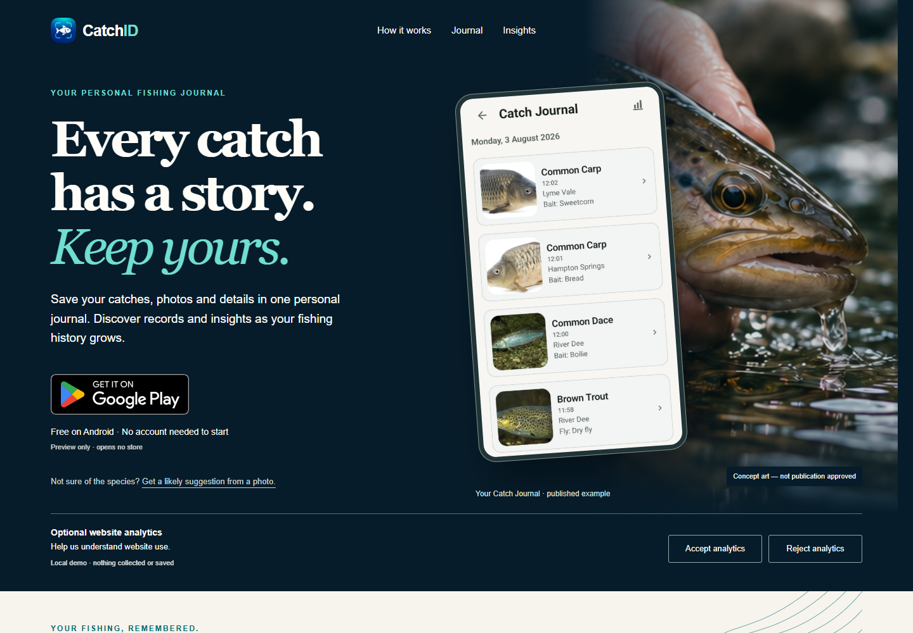
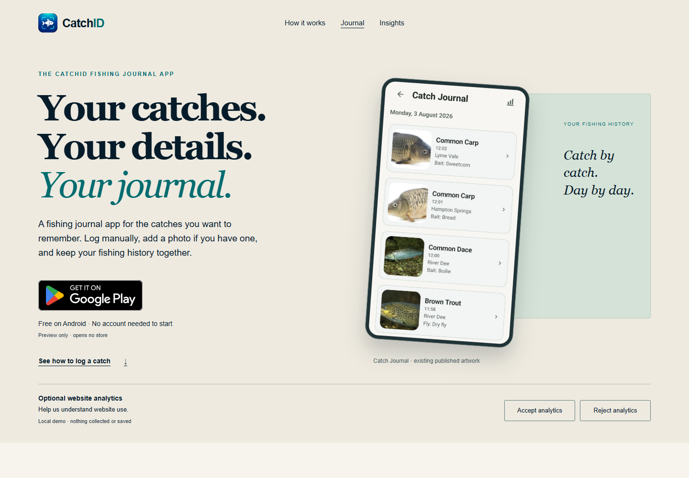

# CID-WEB-CRO-03B — final header cleanup

**DESIGN ONLY — NOT LIVE · 18 November 2026 · self-review**

Pete approved CRO-03A with one final header change. Both review pages now remove the custom desktop **Get CatchID** control completely. There is no replacement button or miniature badge. The logo remains left aligned; the three existing desktop navigation links are centred within the header, with their original 32px gaps, 44px targets and 96px header height. Mobile retains its original logo/Menu layout.

An initial right-aligned arrangement put white Home navigation over bright photography. The selected centred arrangement keeps it over navy and balances the logo without changing the photograph. The [rejected arrangement](evidence/cro03b/rejected-right-alignment-home-1440.png) is retained for transparency.

## Before and after

| Page | Approved CRO-03A | CRO-03B |
| --- | --- | --- |
| Home desktop | [Before](evidence/cro03a/matrix-home-1440x1000-first.png) | [After](evidence/cro03b/matrix-home-1440x1000-first.png) |
| Journal desktop | [Before](evidence/cro03a/matrix-fishing-journal-app-1440x1000-first.png) | [After](evidence/cro03b/matrix-fishing-journal-app-1440x1000-first.png) |
| Home tablet | [Before](evidence/cro03a/matrix-home-768x1024-first.png) | [After](evidence/cro03b/matrix-home-768x1024-first.png) |
| Journal tablet | [Before](evidence/cro03a/matrix-fishing-journal-app-768x1024-first.png) | [After](evidence/cro03b/matrix-fishing-journal-app-768x1024-first.png) |
| Home mobile | [First visit](evidence/cro03b/matrix-home-390x844-first.png) | [Saved choice](evidence/cro03b/matrix-home-390x844-saved.png) |
| Journal mobile | [First visit](evidence/cro03b/matrix-fishing-journal-app-390x844-first.png) | [Saved choice](evidence/cro03b/matrix-fishing-journal-app-390x844-saved.png) |

[Current offline gallery](index.html) · [Archived CRO-03A gallery](CRO03A_GALLERY_ARCHIVE.html) · [Home full page](evidence/cro03b/matrix-home-1440x1000-saved-full.png) · [Journal full page](evidence/cro03b/matrix-fishing-journal-app-1440x1000-saved-full.png).

## Scope and preserved behaviour

The shared generator removes one anchor from each page. The resulting HTML is otherwise byte-identical to approved CRO-03A. The only style addition is a desktop-only header grid in `polish.css`; `design.css` and `design.js` are unchanged. There are no changes to hero typography, imagery, sections, consent or page spacing.

Each page retains exactly two direct Google Play preview actions, both using the unchanged official badge: hero and final section. Existing mobile **Get CatchID** navigation still scrolls to the final section; it is not a direct Play action. Existing navigation destinations, active Journal state and logo link are preserved.

Website branch was clean at `9050b45f49bb841c002dc8175c2e88996ccbda9e`, aligned with its upstream. Fresh main remains `42c997c13712a432c8e2384915aaa010a16d068b`. Ignored caches/build outputs were preserved apart from requested npm reinstall/build output. No unrelated tracked or untracked changes existed.

Current Android main is `ec74bf1f0a2feb3a078e3918f294ea06f3fe2a0d`. Latest AGENTS was read; PROJECT_STATUS was fetched and matched the previously fully read 122,432-character document exactly (blob `55e721f32cb3d34f0d69d3b08e2daa13f003c1fb`). No Android changes. All **213 previous asset/reference/evidence paths** and **78 production-baseline blobs** remain unchanged. The original CRO-03A gallery is archived verbatim.

## Verification

- **36/36 responsive cases pass:** both pages at 320/360/390/430/768/1024/1440, first/saved choices, plus 1.6× text at 320/390. No overflow, clipped text, inaccessible small targets or broken anchors. [Receipt](evidence/cro03b/matrix-verification.json).
- **8/8 header interaction cases pass:** both pages at 390/768/1024/1440. Actual Tab order, visible focus, Enter activation of every navigation link, mobile Menu keyboard opening and automatic closing, logo/navigation alignment and two official badges per page. Existing consent, FAQ, dialog/Escape and reduced-motion checks also pass.
- **6/6 offline cases pass:** gallery and both pages at 390/1440 through file://. Zero external page requests or runtime exceptions. [Receipt](evidence/cro03b/review-verification.json).
- **Scope/source/contrast checks pass:** only authorised header markup/styles change; official asset hashes match; authored colour pairs pass AA. [Receipt](evidence/cro03b/static-verification.json).
- **Pixel comparison:** 43/44 captures match decoded CRO-03A pixels exactly across the entire mobile image or below the 96px desktop/tablet header. The sole mismatch is Journal 360px saved choice: 29,228 pixels in the transformed app image/shadow region, bounds x27–336/y480–799, maximum channel difference 3/255. Source and geometry are identical; visual inspection finds no content/layout change. This minor rasterisation variation is disclosed, not counted as an exact match. [Strict comparison](evidence/cro03b/pixel-verification.json).
- **Existing repository checks pass:** offline `npm ci` using the populated cache; `npm run check` (0 errors, 0 warnings, one existing unused-require hint); `npm run build` (2 routes); `npm run verify` (9 production CTA contracts, 43 files, 2,203,399 bytes); working/staged `git diff --check`. npm retains its esbuild install-script policy warning; configuration was not altered and build/verify succeeded. [Logs](evidence/cro03b/).

The first static audit identified the generator's omitted trailing newline; the original convention is now retained. The first keyboard audit omitted Enter's character event for native `summary`; complete key events open the unchanged Menu correctly. Both original audits remain as `static-first-audit.json` and `matrix-first-audit.json`. No product interaction code was changed to satisfy the harness.

Reproduce using the existing loopback-only server (`qa/serve.mjs`), then `qa/header-browser.mjs matrix`, `qa/header-browser.mjs review`, `qa/header-static.mjs`, and PowerShell `qa/header-pixels.ps1`. The strict pixel comparison deliberately reports its one disclosed mismatch. Browser tests use installed isolated Chrome 157.0.8103.79 at DPR 1; they are not physical-device, Safari, Firefox or screen-reader tests. Existing photography-rights and current-product-capture limitations remain in [asset provenance](ASSET_PROVENANCE.md).

## Delivery boundary

Only `docs/CID-WEB-CRO-03/` is changed on **codex/cid-web-cro-03-design**. The deployment workflow remains main-push/manual-dispatch only; pushing this review branch cannot invoke it. No production edit, main merge, deployment, public preview, Android/Play action or analytics/privacy change. **catchid.app remains untouched.**

The final chat receipt supplies the verified pushed commit SHA and remote readback result.

**One next action:** Pete and ChatGPT review the final desktop headers and confirm design sign-off; production implementation remains a separate decision.
