# CRO-03 visual self-review

**DESIGN CONCEPT — NOT LIVE · 18 November 2026. Self-review, not independent approval.**

One editorial/outdoor system now covers the complete homepage and the existing fishing-journal acquisition page. Open [the offline gallery](index.html) for the most convenient comparison; open either [Home](home.html) or [Fishing Journal](fishing-journal-app.html) for working local interactions.

## What the actual reference images establish

The desktop reference uses a huge three-line serif headline, italic aquatic accent, dark river atmosphere and a large angled product screen. A trout photograph fills the right side rather than sitting in a separate stock-image card. The body and badge form a disciplined left edge; warm paper starts immediately after the hero.

The mobile reference keeps headline → promise → badge → reassurance → product proof. Its phone and trout overlap in a single composition. The sections image moves from warm journal storytelling to dark Insights, pale teal optional ID and a compact navy closing invitation. Thin river contours and careful asymmetry add finish without heavy icon grids.

Those properties, not the fictional UI, are the target. The reference’s compact text and omitted consent are not realistic constraints for every browser viewport. This prototype retains readable web copy and equal consent controls, so its mobile hero is necessarily longer.

## Reference and actual browser comparison

| Approved direction — AI illustration, not product evidence | Actual offline Chrome rendering |
| --- | --- |
| 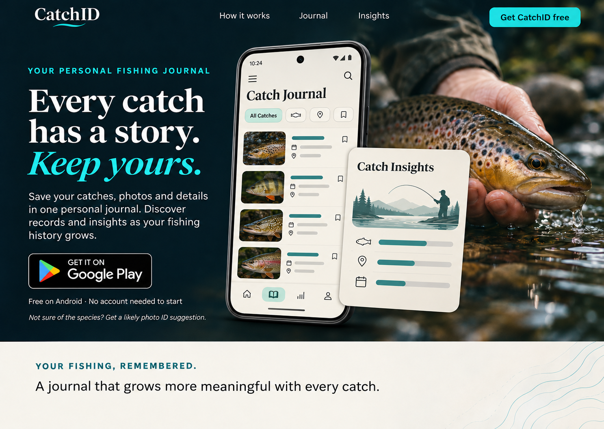 | 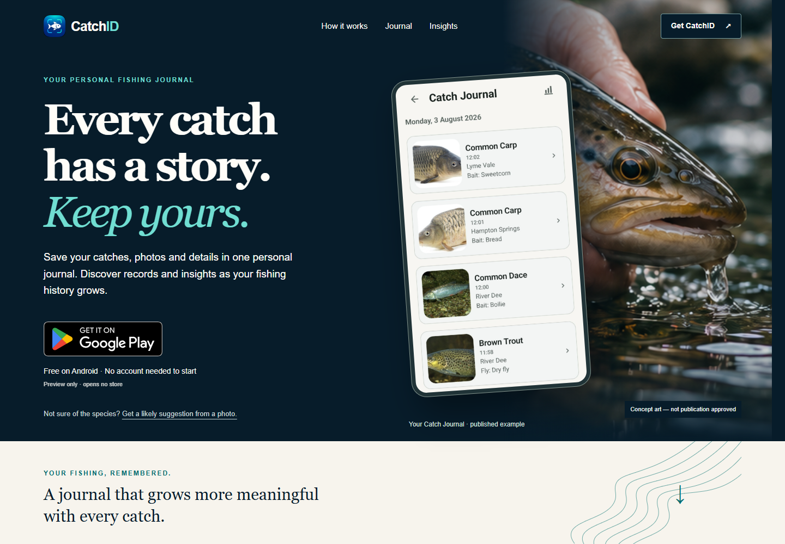 |
|  | 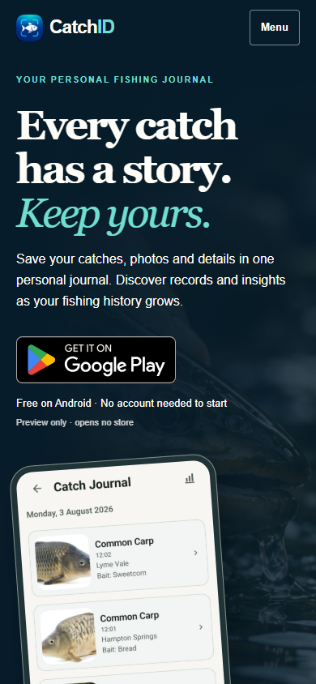 |
| 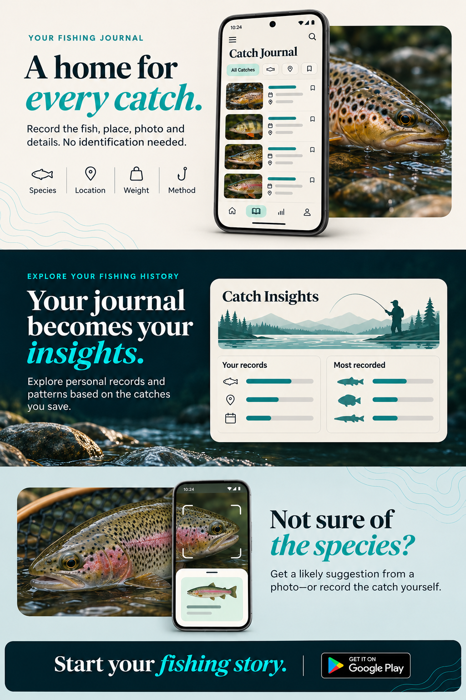 | 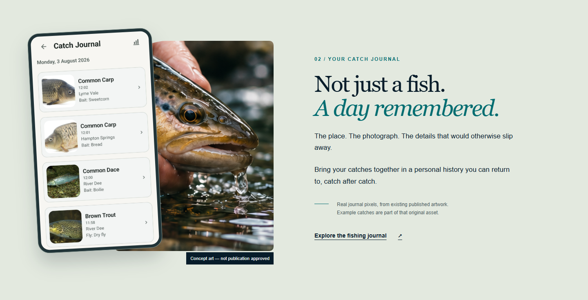 |

Actual additional component crops: [Insights](evidence/section-insights-section-1440.png), [optional ID](evidence/section-identify-section-1440.png). These are screenshots from the browser, not AI images or repainted screens.

## What was weaker in CRO-02

I inspected CRO-02’s rendered desktop A and mobile B evidence, as well as the current source baseline captures. CRO-02’s successful checks did not make it visually approved. Its boxed marketing poster brought its own heading into a second heading hierarchy; the page lacked outdoor atmosphere and a convincing foreground/background relationship. Repeated flat panels, large blank areas and the prototype ribbon weakened the editorial impression. Identification also competed more directly with the journal message.

CRO-03 crops only the marketing surround of the genuine journal artwork, foregrounds that screen over labelled atmosphere, uses stronger display weight, and changes section backgrounds and visual structure intentionally. The actual page designs omit the large review ribbon; the gallery and documentation carry the design-only status.

## Two deliberate refinement passes

### Pass 1 — initial browser → stronger hierarchy and mobile proof

The initial desktop composition established the correct dark/ivory rhythm, but its light-weight headline lacked the reference’s authority. The mobile consent and optional-ID note delayed proof, the landing page’s background words were obscured by the journal, and two mobile Insights screens were too small.

Changes: bold Georgia display weight, larger desktop journal, tighter hero spacing, tertiary ID note removed from the small-screen hero (the full optional-ID section remains), unobscured landing typography, and one readable mobile Personal Records screen with a local link to the full Insights example. Added restrained river-line detail.

| Before | After pass 1 |
| --- | --- |
|  | 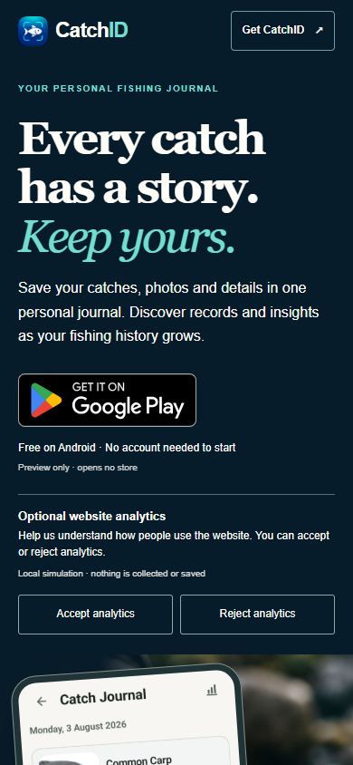 |
| 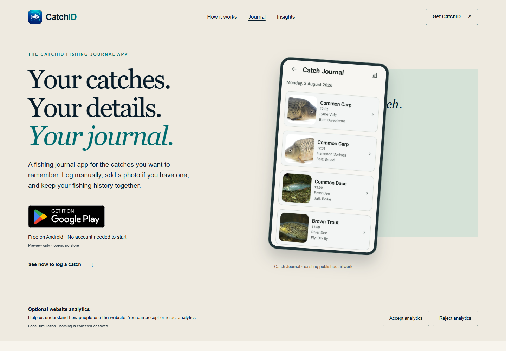 |  |

The 390px primary badge bottom moved from approximately 517px on Home / 513px on Journal to 485px on both. This is a layout measurement, not conversion evidence.

### Pass 2 — atmosphere, readable detail and full-page pacing

Comparing pass 1 with the mobile reference showed that atmosphere still began too late. Full-page review also exposed excess vertical padding around repeated proof, too-small provenance captions and uneven landing-page spacing.

Changes: extended the cropped atmosphere behind the lower mobile hero with a controlled dark overlay; enlarged mobile reassurance/captions; adjusted Journal screen/photo proportions and section spacing; balanced the landing composition; added closing contour detail; kept the Insights screen large instead of squeezing two into a row. The final QA finish adds an accessible mobile disclosure menu, a working skip target, clear caption separation and a conservative photo-overlay contrast bound.

| Pass 1 | Pass 2, then final QA finish |
| --- | --- |
|  | 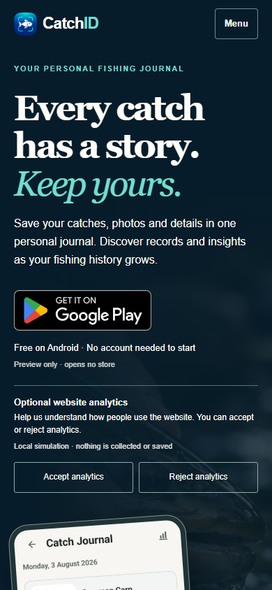 |
| 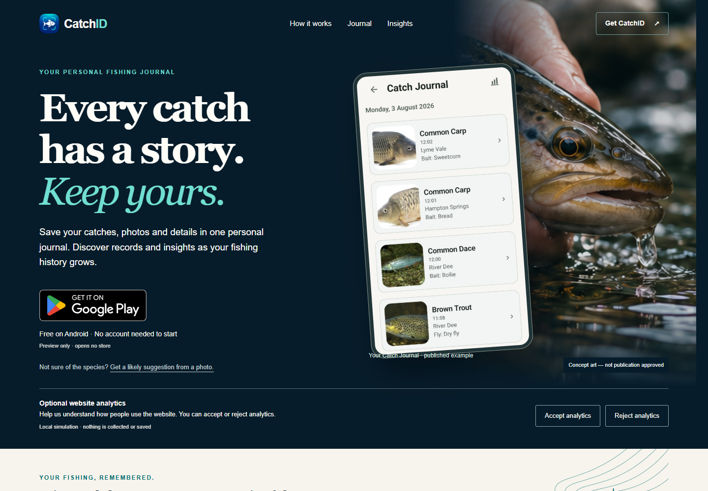 | 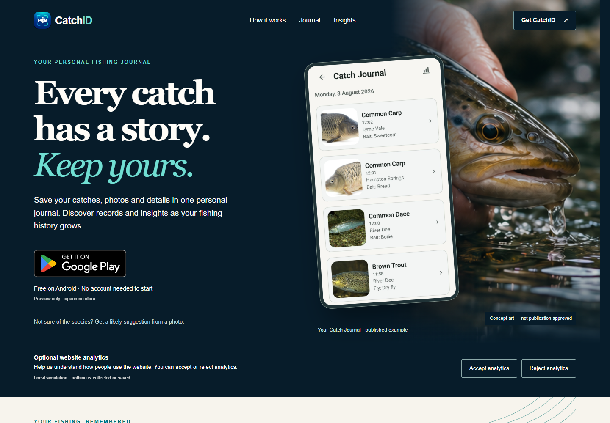 |

The intermediate second-pass evidence is retained as `refine2-*`. Final `matrix-*` captures supersede it for delivery. Final 390px badge bottom is **488.23px** on both routes in first/saved states. Consent is in flow, never hidden or overlaid on the badge. Enlarged text intentionally increases page length.

## Two pages, distinct purposes

| Home | Existing fishing-journal landing |
| --- | --- |
|  | 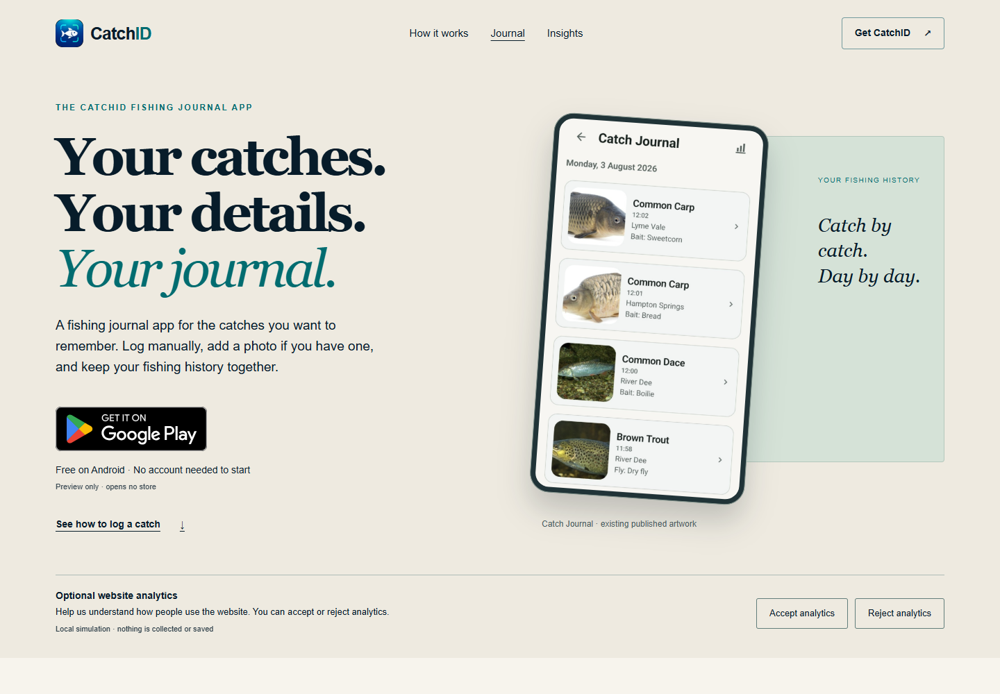 |
|  | 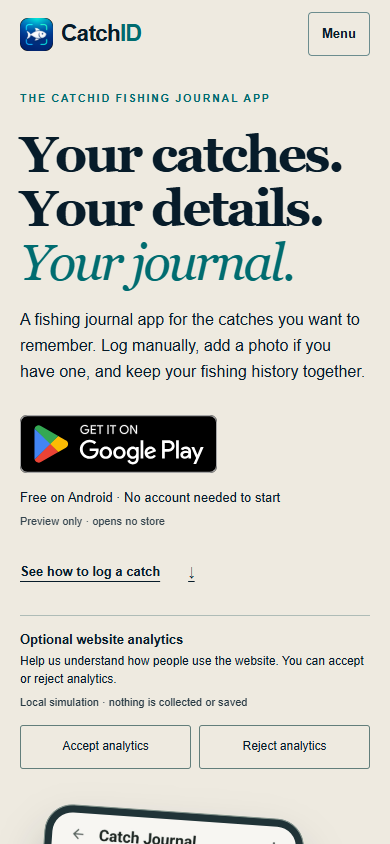 |

Home has seven sections: atmosphere/journal promise; manual recording; memories in the journal; recorded-catch Insights; optional ID; factual trust; FAQ/final invitation. The short paper transition belongs to the hero’s story.

Journal has a warm task-specific opening and three-step logging guide, not a changed-title copy of Home. Shared Insights, optional ID, trust, FAQ, navigation and final badge treatment maintain continuity. Future production campaigns remain distinct and untouched.

Full-page review: [Home desktop](evidence/matrix-home-1440x1000-saved-full.png), [Home mobile](evidence/matrix-home-390x844-saved-full.png), [Journal desktop](evidence/matrix-fishing-journal-app-1440x1000-saved-full.png), [Journal mobile](evidence/matrix-fishing-journal-app-390x844-saved-full.png).

## Sceptical scoring

| Area | Score / 5 | Reason and remaining limit |
| --- | --- | --- |
| Hero resemblance | 4 | Strong serif/italic hierarchy, asymmetrical genuine journal and outdoor depth. The source photo crop is narrower and the real journal is visually denser than the invented reference panel. |
| Professionalism | 4 | Consistent grid, controlled colour shifts, clear badge and restrained details. A full rights-cleared photography set would improve richness and variety. |
| Journal-first story | 4 | Logging precedes records/Insights; optional ID comes later. Complete Add Catch and Catch Details proof remains an explicit asset gap. |
| Consent/badge balance | 4 | Badge is early; equal choices are visible in normal flow. First-visit mobile product proof begins near the bottom of the first viewport; saved-choice proof appears earlier. |
| Mobile composition | 4 | Readable 255–265px primary screens, intentional stacking, native Menu, no tested overflow. Dense source UI cannot be made identical to the spacious fictional UI. |
| Full-page pacing | 4 | Paper, sage, navy and pale teal establish distinct sections; the guide and FAQ vary structure. Home deliberately repeats its one approved populated journal asset. |
| Authenticity | 4 | Asset bytes verified; no invented UI/data or unsupported success claims. Photo is labelled concept art; older screenshot age and missing current detail/form captures prevent publication readiness. |

No critical design score is below 4 after refinement. This is a reasoned self-assessment, not owner approval, pixel-perfect certification or a measured conversion uplift.

## Known compromises and later gates

The full saved-state mobile pages are long because authentic app screens and readable copy take room. The gallery retains complete PNGs, not just favourable hero crops. At 1.6× text the CTA can move below the first viewport; content remains reachable by scrolling without clipping.

The current baseline still includes stale “No adverts” copy. Baseline screenshots are context only, never proposed copy; this design acknowledges advertising without altering production. No app-version number appears in proposed copy.

Read [asset provenance](ASSET_PROVENANCE.md) for exact crop coordinates and missing captures. Physical Android/iOS, Safari, Firefox, assistive-technology and owner visual acceptance have not been performed. These are later rollout considerations, not approval implied by this milestone.

**One next action:** Pete and ChatGPT inspect the gallery and approve or request revisions to this design. No implementation or publication is implied.
