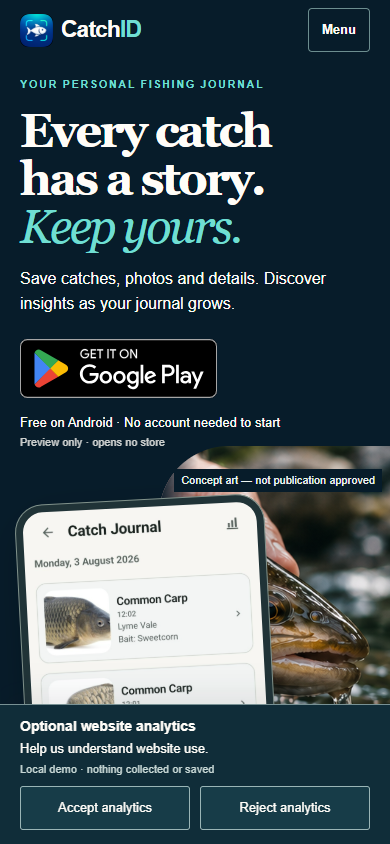
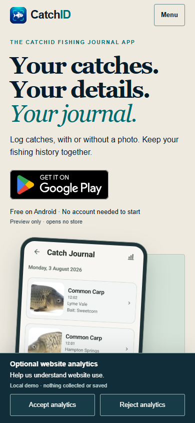
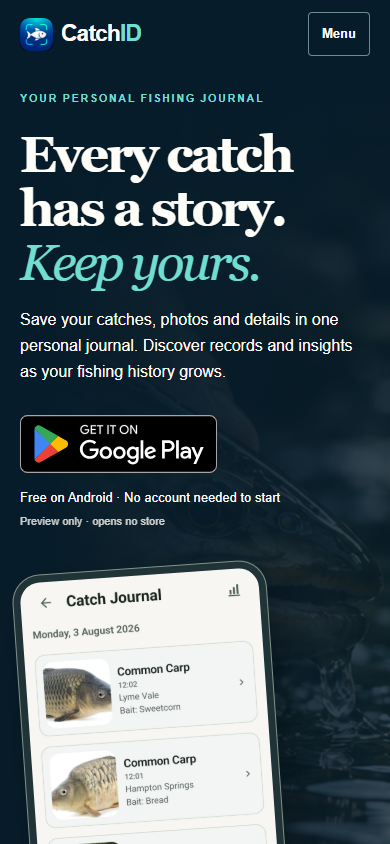
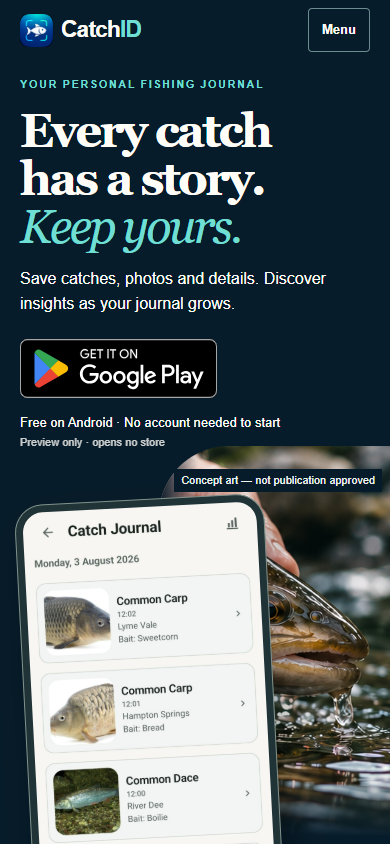
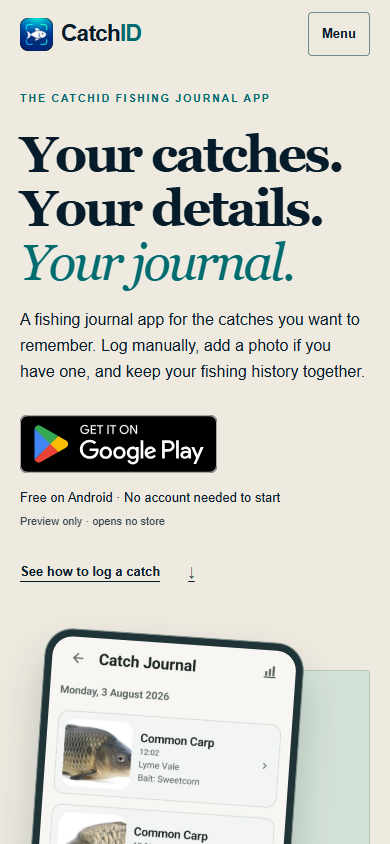
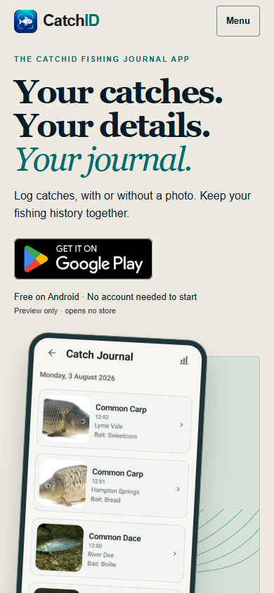
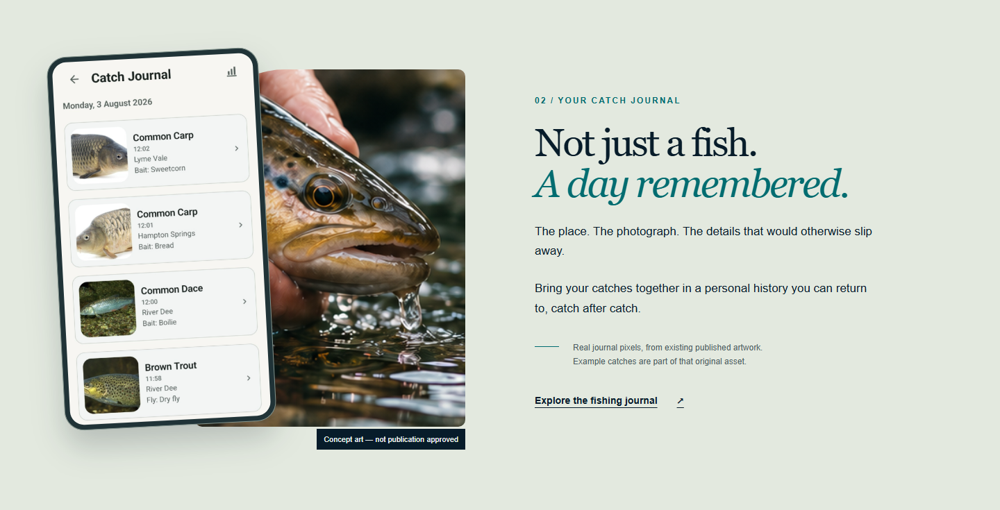
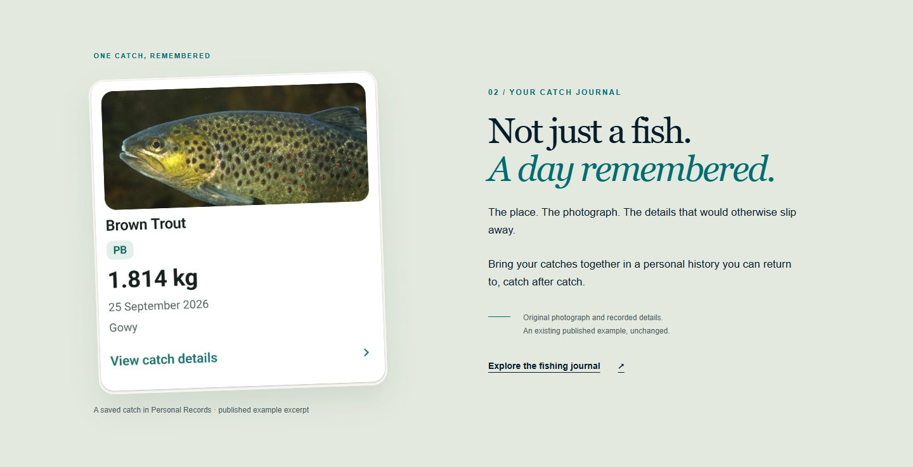
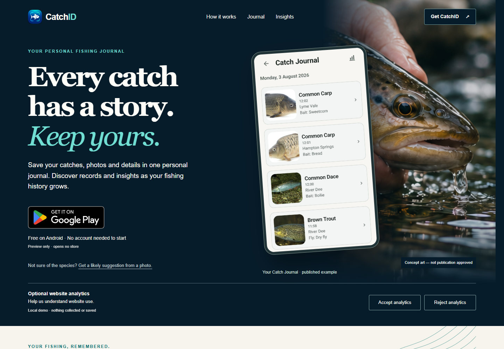
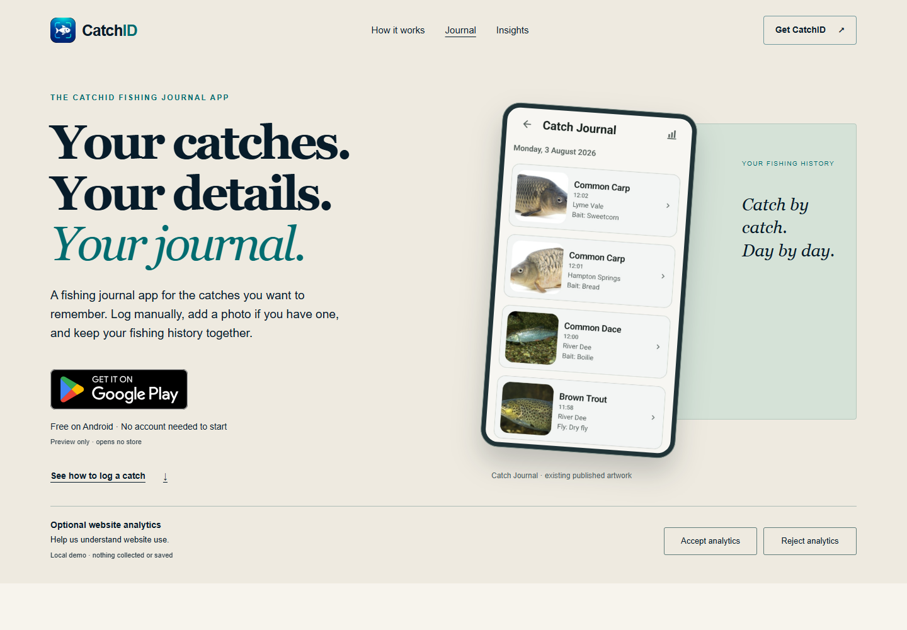

# CRO-03A — focused visual polish

**DESIGN CONCEPT — NOT LIVE · 18 November 2026. Self-review, not independent approval.**

Pete and ChatGPT approved CRO-03’s direction at `d0df9e0bdfc0c23fbdc0db1fad94dd948ab7f5a6`. This milestone refines three specific points; it does not replace that direction or authorise implementation. The previous [visual review](CRO03_VISUAL_REVIEW_ARCHIVE.md), [QA](CRO03_QA_ARCHIVE.md), [handover](CRO03_HANDOVER_ARCHIVE.md), screenshots, references and asset bytes remain available.

Open the [updated gallery](index.html), [Home](home.html) or [Fishing Journal](fishing-journal-app.html). All work offline.

## 1. Earlier mobile product proof

The homepage headline is unchanged. Slightly tighter display sizing, shorter mobile-only supporting copy and reduced spacing bring the unchanged official badge forward. The genuine journal follows the reassurance directly. Consent uses an opaque bottom panel on small screens, with equally styled/sized Accept and Reject buttons. Desktop consent stays in flow.

| CRO-03: first visit, 390 × 844 | CRO-03A: first visit, 390 × 844 |
| --- | --- |
|  |  |
|  |  |

| Measured at 390 × 844, normal text | CRO-03 | CRO-03A |
| --- | ---: | ---: |
| Primary badge button bottom, either page | 488.23px | 412.73px |
| Home journal pixels begin, first visit | 743.01px | 500.90px |
| Journal landing journal pixels begin, first visit | 810.84px | 479.78px |
| Home journal pixels begin, saved choice | 567.43px | 500.90px |
| Journal landing journal pixels begin, saved choice | 635.26px | 479.78px |

These are layout measurements, not conversion results. A complete saved-catch row is now recognisable above consent at 390px. The panel occupies the bottom 139.83px; each choice is 170 × 44px. Nothing is preselected, hidden or tracked. At 320 × 720 the product slice is smaller: its heading and the first catch begin above the panel, with more available by scrolling.

The panel’s measured height reserves end-of-page space. Keyboard focus is scrolled clear of it. Reopening consent returns focus to the footer opener after a choice. At 1.6× text the hero becomes longer and the CTA can move below the first viewport; it remains reachable without clipping or being covered when focused. These are offline design interactions, not production consent changes.

## 2. Brighter mobile photograph

The photograph previously sat behind text at 30% opacity. It now occupies a bounded area below the copy, at full opacity beside the journal, with its head raised into the visible composition. The mobile crop uses the same unchanged reference file. Its concept label has an opaque navy background; bright photography does not reduce web text contrast.

| CRO-03: saved choice | CRO-03A: saved choice |
| --- | --- |
|  |  |
|  |  |

It remains **Concept art — not publication approved**. Brightness comes from removing the display overlay, not retouching pixels or acquiring rights. The journal deliberately overlaps part of the fish, with its face/water now distinct beside it. The narrow source crop remains a resolution/rights limitation for a later rollout.

## 3. Less repeated full-page proof

The second populated Journal phone and repeated concept photograph have been removed from the Journal story section. A genuine saved-record card now shows its original photograph, weight, date and location at a readable scale. It is explicitly a **Personal Records excerpt**, not a claimed Catch Details screenshot.

| CRO-03 Journal section | CRO-03A Journal section |
| --- | --- |
|  |  |

Home now uses the populated Journal artwork **once**, in the hero. The next proof is the actual Add a catch controls, then a saved-record excerpt, then existing Insights screens. Insights, optional identification and trust markup is byte-identical on both routes. The seven-section architecture is retained.

The Brown Trout still appears later inside the preserved Personal Records screen. This remaining reuse is explicit: the detail/overview compositions differ, but no new asset is claimed. A current approved Catch Details capture would be the stronger eventual replacement. Historical Android composites and disposable test captures were inspected and rejected as marketing proof; [exact missing-asset requirements](ASSET_PROVENANCE.md) are recorded.

## Two browser passes and arrangement selection

**Pass 1:** compact mobile typography/copy, bottom consent, brighter photograph and saved-record composition. The first catch became visible and the badge moved 75.5px earlier. Actual screenshots showed the fish still too low beside the screen.

**Pass 2:** raised and narrowed the photo area, selected a tighter mobile crop, separated the concept label from app content and adjusted the screen relationship. The final finish equalises desktop consent widths and avoids the extra headline wrap at 768px. Focus testing addresses the new panel’s real obstruction risk.

| Pass 1 | Final |
| --- | --- |
|  |  |

A compact **inline alternative** was also rendered: [capture](evidence/cro03a/inline-option-home-390x844-first.png). It kept consent between the CTA and product and delayed the journal. The selected bottom arrangement gives the stronger immediate reading order while keeping both choices visible. It adds a fixed-panel/focus-management tradeoff; that is documented and tested.

## Desktop continuity and full-page pacing

| Home desktop | Fishing Journal desktop |
| --- | --- |
|  |  |

Desktop retains the approved serif, navy/teal/paper composition and original supporting copy. The landing page keeps its practical opening and logging guide. Full saved-choice pages: [Home mobile](evidence/cro03a/matrix-home-390x844-saved-full.png), [Journal mobile](evidence/cro03a/matrix-fishing-journal-app-390x844-saved-full.png), [Home desktop](evidence/cro03a/matrix-home-1440x1000-saved-full.png), [Journal desktop](evidence/cro03a/matrix-fishing-journal-app-1440x1000-saved-full.png). Use saved-state full pages for pacing and first-viewport captures for the fixed consent relationship.

## Sceptical judgement

- **Early understanding improves:** real catch content accompanies the promise and badge on the first mobile view.
- **Outdoor atmosphere improves:** the fish/water are distinct without body text over the bright area. It is still narrow concept art, not production photography.
- **Professionalism improves within the approved direction:** deliberate consent placement and varied proof scale, without extra effects or feature grids.
- **Variety improves with a limit:** the repeated Journal phone is removed, but the excerpt shares a source with Insights. Missing current Details/Form captures remain unresolved.
- **Accessibility is tested, not universally certified:** seven widths, two states, 1.6× text and actual keyboard traversal pass. The fixed panel uses viewport space, especially on short/enlarged-text screens. Physical devices, Safari, Firefox and screen readers were not tested.

No UI, catch, feature, score or conversion benefit was invented. Screenshot age, photography rights and owner acceptance remain separate from passing checks.

**One next action:** Pete and ChatGPT inspect CRO-03A’s before/after gallery and approve or request final revisions. No implementation or publication is implied.
