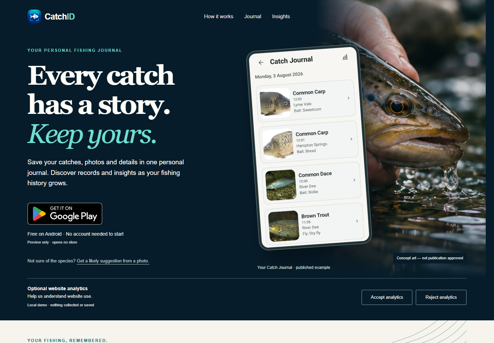
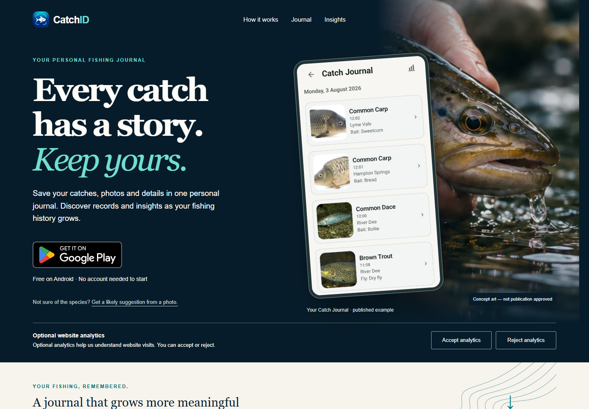
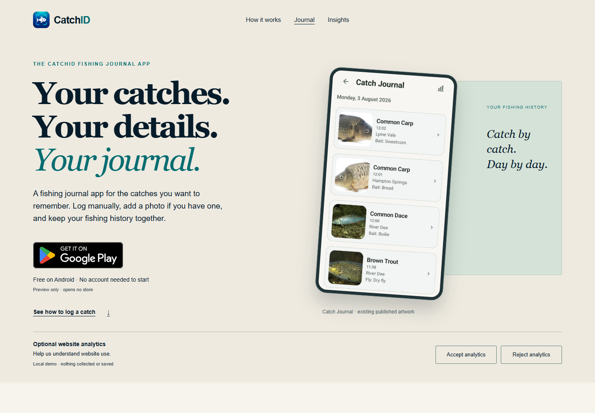
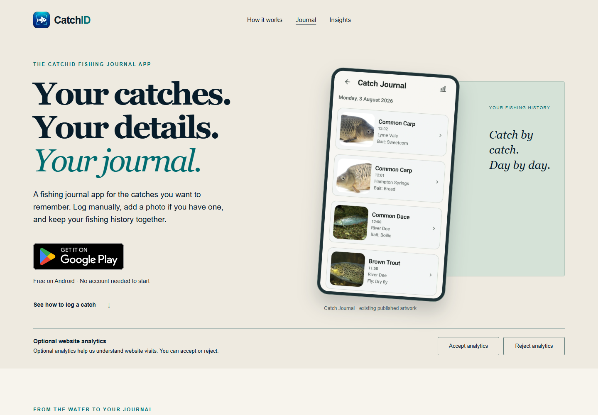
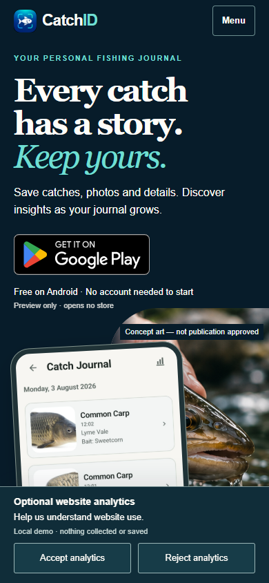
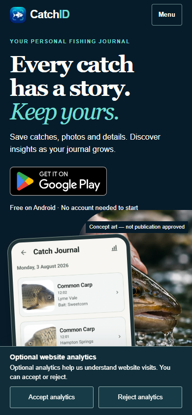
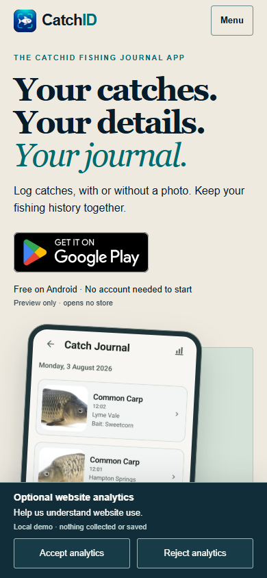
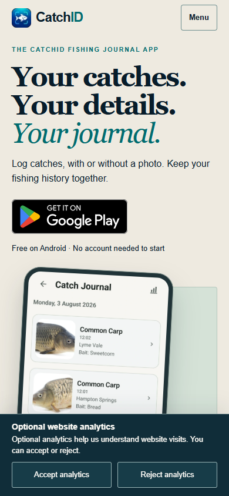

# CRO-04 — implementation visual review

**IMPLEMENTATION CANDIDATE — NOT LIVE · 19 November 2026 · self-review, not independent approval.**

The approved CRO-03B direction is implemented in Astro. The comparison source is commit `9c7b0847061a460aa095150a6e2dd1972ba7a436`; copied reference PNGs are exact committed bytes, verified by [source audit](evidence/source-audit.json). [Offline comparison gallery](index.html).

## Desktop

| Approved Home | Implemented Home |
| --- | --- |
|  |  |

| Approved Fishing Journal | Implemented Fishing Journal |
| --- | --- |
|  |  |

Typography, navy/teal/paper colours, section order, genuine product crops and visual scale follow the approved reference. The left logo and centred navigation remain; no header download control replaces the removed button. Each page has exactly two official Google Play badge links.

## Mobile first visit

| Approved Home | Implemented Home |
| --- | --- |
|  |  |

| Approved Fishing Journal | Implemented Fishing Journal |
| --- | --- |
|  |  |

At 390×844, the primary badge's bottom remains **412.73px** on both pages. Journal frame dimensions are identical to the reference, and the frame starts **18.5px earlier** after removing the non-production “Preview only” line. The real consent panel is **140.28px** high versus **139.83px** in the prototype. Both choices remain 170×44px. A real catch is visible above the panel.

Saved-choice screenshots: [Home](evidence/matrix-home-390x844-saved.png), [Fishing Journal](evidence/matrix-fishing-journal-app-390x844-saved.png). [Exact comparison metrics](evidence/comparison-metrics.json).

## Full-page pacing

| Route | Approved desktop / mobile | Implemented desktop / mobile |
| --- | --- | --- |
| Home | [Desktop](reference/matrix-home-1440x1000-saved-full.png) · [Mobile](reference/matrix-home-390x844-saved-full.png) | [Desktop](evidence/matrix-home-1440x1000-saved-full.png) · [Mobile](evidence/matrix-home-390x844-saved-full.png) |
| Fishing Journal | [Desktop](reference/matrix-fishing-journal-app-1440x1000-saved-full.png) · [Mobile](reference/matrix-fishing-journal-app-390x844-saved-full.png) | [Desktop](evidence/matrix-fishing-journal-app-1440x1000-saved-full.png) · [Mobile](evidence/matrix-fishing-journal-app-390x844-saved-full.png) |

The homepage preserves its seven-section progression: hero, manual entry, journal story, Insights, optional identification, trust, then FAQ/final invitation. The distinct landing page retains its practical logging guide. The Personal Records excerpt remains honestly labelled and is not represented as a Catch Details screen.

## Necessary production differences

- Real tracked Play links replace preview buttons/dialogs. Privacy and support are genuine destinations; review-only navigation/labels are removed.
- The real consent component replaces the simulation. Its analytics logic is unchanged; the presentation reserves space, handles focus and allows scrolling within an enlarged/short-screen panel.
- Trust copy retains the existing qualified restore conditions and explicitly optional Google sign-in. Advertising is acknowledged; no historical production version or ad-free promise is carried forward.
- Images are locally encoded for delivery from unchanged original sources. No app UI, catch, result or statistic is generated. The hero still clearly says **Concept art — not publication approved**.
- The normal header composition is retained. At enlarged tablet text, its first grid column now respects the unbroken wordmark rather than splitting “CatchID”. This was found by visual review even though the first overflow audit passed.

## Sceptical judgement and limits

The candidate retains the premium editorial hierarchy and early genuine product proof rather than merely approximating the reference with a generic layout. Both actual full pages were inspected. Normal-size badge placement and product-frame geometry match; the production-only copy differences explain the slightly shorter page/hero heights.

The tablet wordmark issue was corrected and all seven widths retested at normal and 1.6× text. Enlarged text can require scrolling before the badge appears; it remains accessible. The fixed consent panel consumes viewport space and is deliberately capped at half the dynamic viewport, with keyboard visibility verified.

The photograph remains narrow concept art, not approved production photography. The saved-record excerpt still shares a source with the full Personal Records proof. Current approved complete Add Catch/Catch Details and refreshed app captures remain asset decisions, not fabricated deliverables. Browser emulation and local layout-shift observations do not establish physical-device or field performance. No conversion improvement is claimed.

**One next action:** Pete and ChatGPT review the implementation candidate. Publication requires separately resolving [release gates](ASSET_RELEASE_GATES.md) and Pete's explicit approval.
