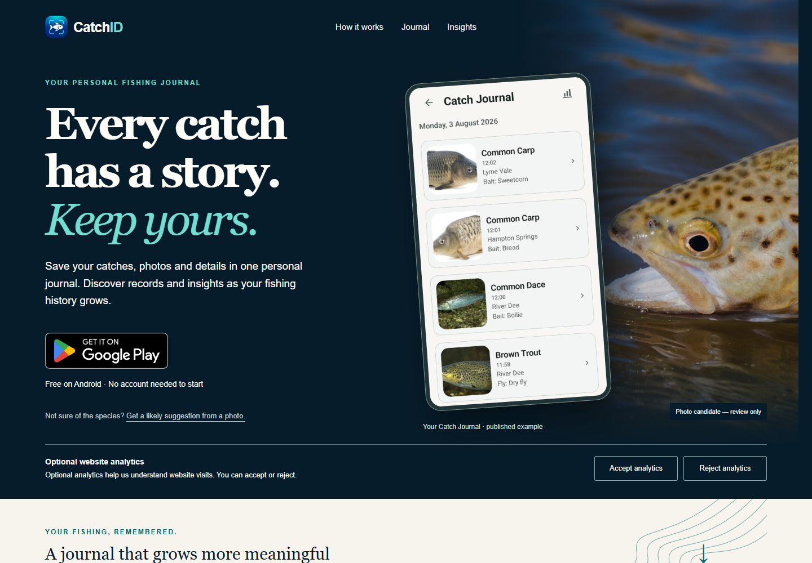
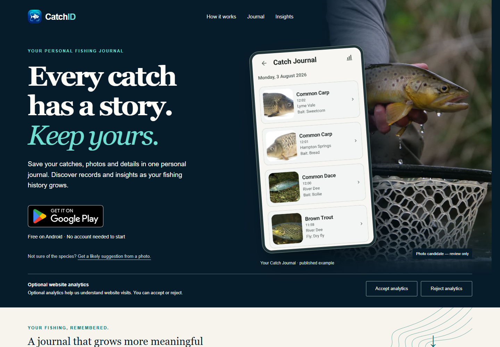
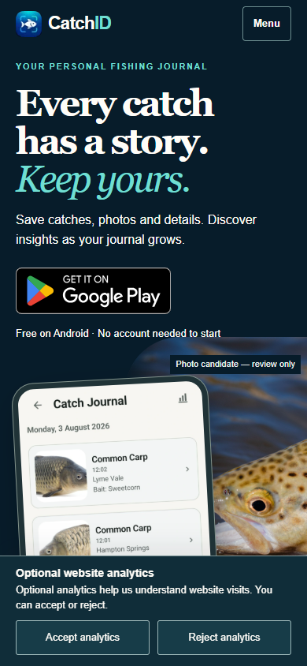
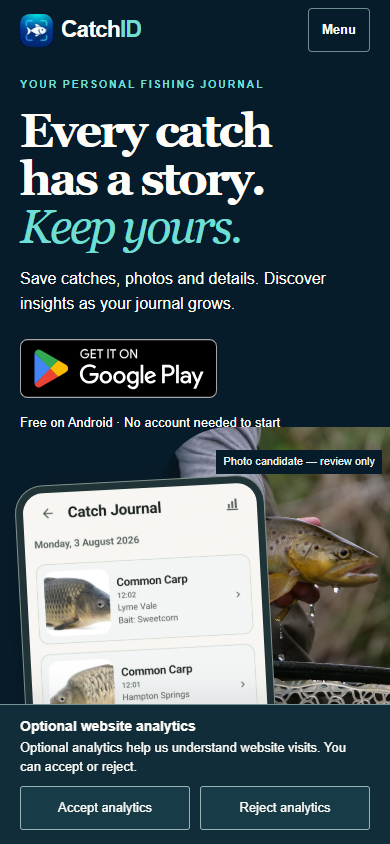

# CRO-05 — hero photography comparison

**DESIGN ONLY — NOT LIVE · 19 November 2026 · self-review.**

**Recommendation: Variant A, Photo 1 by Patagonia Savage.** Its large eye, spotted head and waterline give the hero a more immediate, intimate fishing moment. The blue water blends into the existing navy composition, while the fish faces inward towards the journal. It needs no extra zoom or colour treatment. Photo 3 is a credible alternative, but the sleeve and net introduce more competing detail.

[Side-by-side gallery](index.html) · [Source/licensing record](PROVENANCE.md) · [QA and reproduction](QA.md)

Baseline: `codex/cid-web-cro-04-implementation` at **`651ae58f39a8c2530fb600b35e91455c644351e8`**. Review branch: **`codex/cid-web-cro-05-hero-photography`**. Only files under `docs/CID-WEB-CRO-05/` are added. Production source, CRO-04 evidence and the Fishing Journal page are unchanged.

## Desktop · 1440 × 1000

| A — Photo 1, Patagonia Savage | B — Photo 3, Giant Asparagus |
| --- | --- |
|  |  |

## Mobile · 390 × 844

| A — Photo 1 | B — Photo 3 |
| --- | --- |
|  |  |

These show the real first-visit consent panel. Saved-decision captures: [A desktop](evidence/variant-a-1440-saved.png), [A mobile](evidence/variant-a-390-saved.png), [B desktop](evidence/variant-b-1440-saved.png), [B mobile](evidence/variant-b-390-saved.png).

Complete heroes: [A desktop](evidence/variant-a-1440-hero.png), [A mobile](evidence/variant-a-390-hero.png), [B desktop](evidence/variant-b-1440-hero.png), [B mobile](evidence/variant-b-390-hero.png). Full mobile pages: [A](evidence/variant-a-390-full.png), [B](evidence/variant-b-390-full.png). All are browser captures, with no compositing or post-processing.

## Judgement against the brief

| Criterion | Variant A — Photo 1 | Variant B — Photo 3 |
| --- | --- | --- |
| Desktop quality | Stronger fit: large, sharp fish detail and calm water beside the journal. | Convincing outdoor moment, but the high-contrast net occupies much of the lower photo. |
| Mobile quality | Large eye and markings remain clear beside the journal. The lower jaw meets the consent panel; its waterline is clearer after rejection. | Fish sits higher and more fully above consent, a real advantage. It remains smaller despite a modest zoom. |
| Fish recognisability | Immediate close-up of a spotted trout; a deliberate head crop, not a whole-fish portrait. | Clear trout head and some body; more of the full source fish is hidden by the unchanged journal overlay. |
| Journal harmony | Inward-facing fish and blue water support the product proof without changing its scale or position. | Outward-facing fish, mesh pattern and sleeve create more competing directions and texture. |
| Emotional / premium feel | More intimate and atmospheric; the waterline relates naturally to remembering a catch. | More documentary and action-oriented; authentic-looking equipment and water droplets. |
| Readability / contrast | Cream/mint text remains on the existing dark field. No extra overlay needed. | Same readable text field. No extra overlay needed; existing edge fades contain the busier background. |
| Publication suitability | Preferred photographic candidate, subject to owner selection and source-rights checks. | Plausible candidate, with a less restrained fit in this specific composition. |

This is a visual judgement, not a conversion experiment or independent authentication of photographic origin. Both sources look photographic and are credited as photographs on Pexels. Neither is presented as a CatchID user's recorded catch or photographer endorsement.

## Exact treatment and scope

The unchanged CRO-04 build is served locally. The review server replaces only the homepage hero photo block, adds a scoped image-fit rule, and changes its existing provenance label to **“Photo candidate — review only”**. That label/alt-text correction avoids falsely describing these photos as AI concept art. All marketing copy, typography, spacing, journal artwork, header, badges, consent scripts, tracked URLs and the rest of the page remain identical.

| Treatment | A | B |
| --- | --- | --- |
| Fit | `object-fit: cover` | `object-fit: cover` |
| Desktop position | `35% 50%` | `54% 50%` |
| Mobile position | `30% 50%` | `50% 50%` |
| Scale | `1` | `1.25`, origin `60% 38%` |
| Colour / overlays | Original photo colour; existing CRO-04 opacity and gradients only | Same |

The initial wider Photo 3 fit is retained for transparency: [desktop](evidence/initial-fit/variant-b-1440-first.png), [mobile](evidence/initial-fit/variant-b-390-first.png). Its final tighter crop improves the fish's prominence without moving any other element. No mirroring, retouching, synthetic extension or generated content was used.

## Limitations and publication gates

Only desktop Chromium emulation at the requested widths was used for this comparison. Physical devices, Safari/WebKit, Firefox and assistive technologies were not re-tested. Existing CRO-04 gates for current genuine product captures and wider browser/accessibility acceptance remain open. No production analytics reporting was tested or sent.

Original high-resolution JPEGs are retained for source provenance, not optimised production delivery. A later authorised implementation should encode responsive renditions and recheck the selected crop, contrast and image weight. This review does not replace CRO-04's concept asset in production source or clear its publication blocker by itself. Pexels licensing permits relevant use subject to its terms; it is not Pete's publication approval.

No main merge, deployment, public preview, catchid.app change, Android change, Play Store action or marketing action. The final delivery receipt identifies the pushed review commit and remote readback.

**Exactly one recommended next action:** Pete and ChatGPT review and select Variant A / Photo 1 for a separately authorised implementation step.
