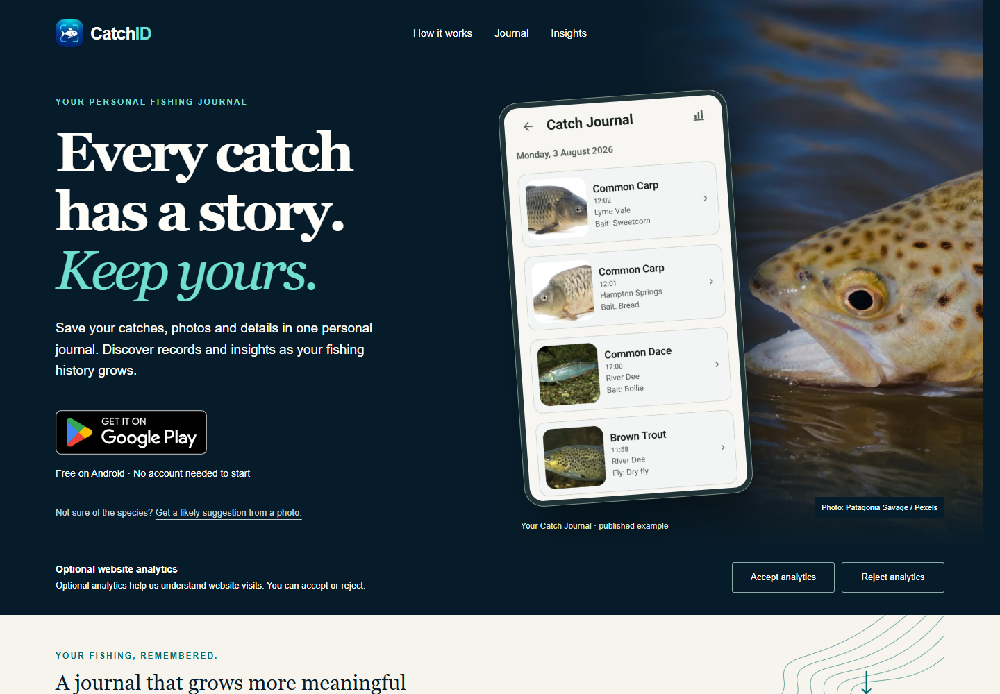

# CRO-06 — approved composition versus implemented delivery

**Sceptical self-review · 19 November 2026 · implementation candidate, not live.**

## Desktop first visit · 1440 × 1000

| Approved CRO-05 A | CRO-06 implementation |
| --- | --- |
|  |  |

## Mobile first visit · 390 × 844

| Approved CRO-05 A | CRO-06 implementation |
| --- | --- |
|  |  |

## Saved decision and complete pages

| View | Approved | Implemented |
| --- | --- | --- |
| Desktop, saved rejection | [CRO-05](reference/variant-a-1440-saved.png) | [CRO-06](evidence/matrix-home-1440x1000-saved.png) |
| Mobile, saved rejection | [CRO-05](reference/variant-a-390-saved.png) | [CRO-06](evidence/matrix-home-390x844-saved.png) |
| Complete homepage | — | [Desktop](evidence/matrix-home-1440x1000-saved-full.png) · [Mobile](evidence/matrix-home-390x844-saved-full.png) |
| Fishing Journal first visit | Unchanged CRO-04 build | [Desktop](evidence/matrix-fishing-journal-app-1440x1000-first.png) · [Mobile](evidence/matrix-fishing-journal-app-390x844-first.png) |

## Assessment

The recognisable eye, spotted head and waterline retain the approved position. The brighter journal remains the primary product proof. Headline, typography, colour, spacing, navigation, badge positions, consent and subsequent sections are unchanged. The old review label becomes a small photography credit within the existing label area; it adds no control or new visual block.

Four before/after pixel comparisons show **zero changed pixels outside the photo-frame rectangle**, allowing a 2/255 per-channel tolerance. Inside that rectangle, differences are expected from WebP resampling/compression and the accurate credit. Reference screenshots match the exact approved Git commit. [Audit](evidence/source-image-visual-audit.json).

Both normal desktop and mobile renders were inspected, together with 320px, 768px and enlarged tablet text. At 320px, the preserved consent panel initially hides more of the fish; scrolling/saved rejection reveals it. At 390px the eye remains visible beside the journal above consent, matching the approval. Enlarged text needs scrolling before the badge, as in the baseline; keyboard focus remains reachable. These are documented constraints of the retained layout, not grounds to change the authorised crop or scale.

The JPEG fallback and DPR 1/2/3 selections decode successfully. The uncompressed source has more fine detail, but the chosen renditions retain the fish's definition at normal viewing sizes, with higher-resolution variants for dense displays. No new overlay, zoom, mirroring or artificial extension was needed. No photo-specific defect requiring a departure from the approved treatment was found.

The Fishing Journal page's built HTML is byte-identical to CRO-04 and all of its responsive/interaction cases pass. Global CSS and every product screenshot remain unchanged. The old concept asset is retained in source/history but absent from production output.

Limits: Chromium emulation, not physical devices or an independent reviewer. Firefox, Safari/WebKit, screen-reader and current authentic product-capture gates remain open. This review does not establish improved conversion or publication readiness.
